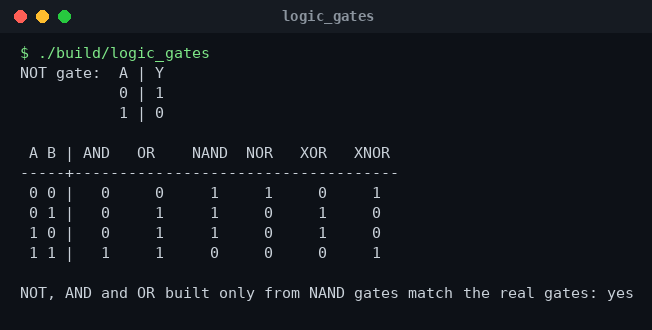
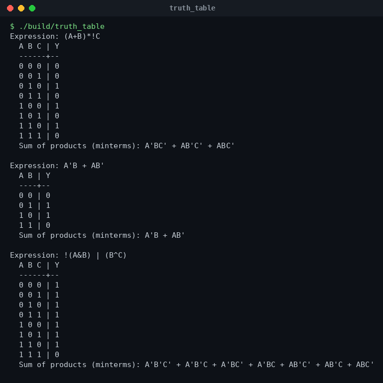
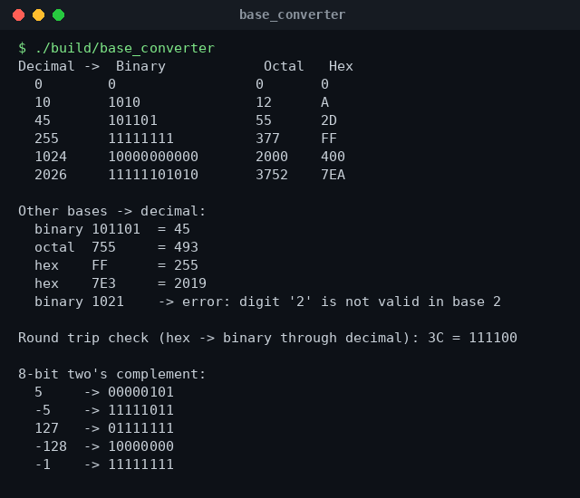
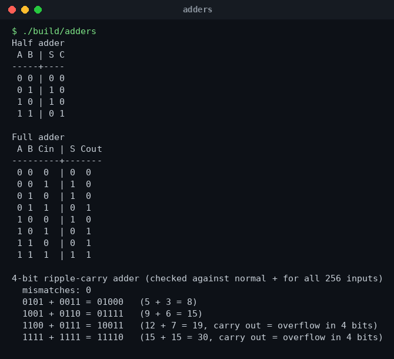

# Digital Logic Projects (C++)


Small C++ programs for my **Digital Logic Design (DLD)** course. Instead of only drawing circuits on paper, I simulated them in code and checked them against truth tables.

| Program | What it does |
|---|---|
| `01-logic-gates/logic_gates.cpp` | Truth tables for NOT, AND, OR, NAND, NOR, XOR, XNOR + proof that NAND is a universal gate |
| `02-truth-table-generator/truth_table.cpp` | Parses any Boolean expression and prints its truth table and sum-of-products (minterms) |
| `03-number-base-converter/base_converter.cpp` | Decimal ↔ binary / octal / hex, input validation, 8-bit two's complement |
| `04-adders/adders.cpp` | Half adder, full adder and a 4-bit ripple-carry adder tested on all 256 inputs |

## Build and run

```bash
./build_all.sh
./build/truth_table "(A+B)*!C" "A'B + AB'"
```

The truth-table generator accepts `!` `~` or `'` for NOT, `&` or `*` for AND (or just write `AB`), `|` or `+` for OR, `^` for XOR, and parentheses.

## Boolean algebra basics

| Law | AND form | OR form |
|---|---|---|
| Identity | A · 1 = A | A + 0 = A |
| Null | A · 0 = 0 | A + 1 = 1 |
| Idempotent | A · A = A | A + A = A |
| Complement | A · A' = 0 | A + A' = 1 |
| Commutative | A · B = B · A | A + B = B + A |
| Associative | (A · B) · C = A · (B · C) | (A + B) + C = A + (B + C) |
| Distributive | A · (B + C) = A·B + A·C | A + B·C = (A + B)(A + C) |
| Absorption | A · (A + B) = A | A + A·B = A |
| De Morgan | (A · B)' = A' + B' | (A + B)' = A' · B' |

**Adders**

- Half adder: `S = A ⊕ B`, `C = A · B`
- Full adder: `S = A ⊕ B ⊕ Cin`, `Cout = A·B + Cin·(A ⊕ B)`
- A ripple-carry adder chains full adders; the carry of each bit is the input carry of the next.

**Number bases:** to convert decimal → base *b*, divide by *b* repeatedly and read the remainders backwards; to convert back, multiply each digit by its place value (*b⁰, b¹, b²…*) and add.

## Sample output









## Author

**Dheya Alhag** — BS Software Engineering, Superior University, Lahore
GitHub: [@dhiaalhaq7979](https://github.com/dhiaalhaq7979)
